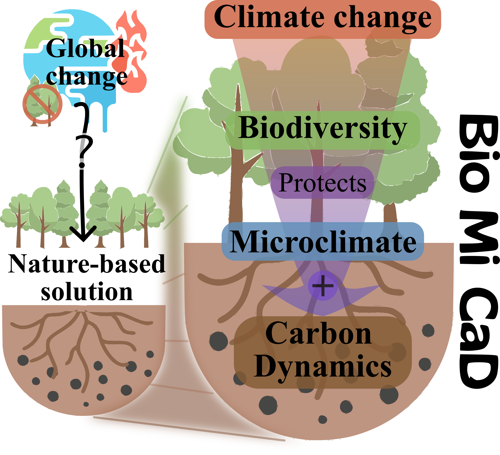

## Abstract

Forests represent a promising Nature-based Solution for climate regulation, given their high potential for carbon sequestration. The processes underlying forest carbon dynamics are profoundly shaped by biodiversity and climate, yet their interplay is often ignored. Notably, vegetation and its diversity shape microclimates, proximal climate experienced by organisms and ecosystem
processes, thereby providing a potential buffer against the impact of climate change on ecosystems. However, Biodiversity–Ecosystem Functioning (BEF) experiments, while designed to assess how biodiversity loss affects ecosystem processes, mostly disregard these microclimatic dynamics, limiting our ability to predict forest responses to the intertwined climate and biodiversity change.

The BioMiCaD project aims for a paradigm shift by placing microclimate at the core of the BEF framework, providing the first integrative approach to understand Biodiversity–Microclimate–Carbon Dynamics relationships. I will explore how tree species richness shapes microclimates and mediates carbon dynamics across spatial and temporal scales.

Four objectives will drive the project:

1. Quantifying how tree diversity affects microclimate and forest carbon dynamics across European macroclimatic conditions using long-term field sites and BEF experiments;

2. Identifying the mechanisms underlying the BioMiCaD relationships by manipulating species richness and microclimate at ecosystem-level using Ecotron experiments;

3. Predicting the combined influence of biodiversity and microclimate on forest carbon dynamics under future climate and biodiversity scenarios by implementing mechanistic models;

4. Identify the promising forest-based climate mitigation strategies. 

BioMiCaD will link ecology, biogeochemistry, and climate modeling to show how biodiversity shapes microclimates and ecosystem functioning, thus providing insights for forest management and climate mitigation strategies.

## Hypothesis

Our main hypothesis is that vegetation diversity can buffer temperature fluctuations and extreme climatic event, and therefore, reduce the effects of climate change on carbon dynamics.

